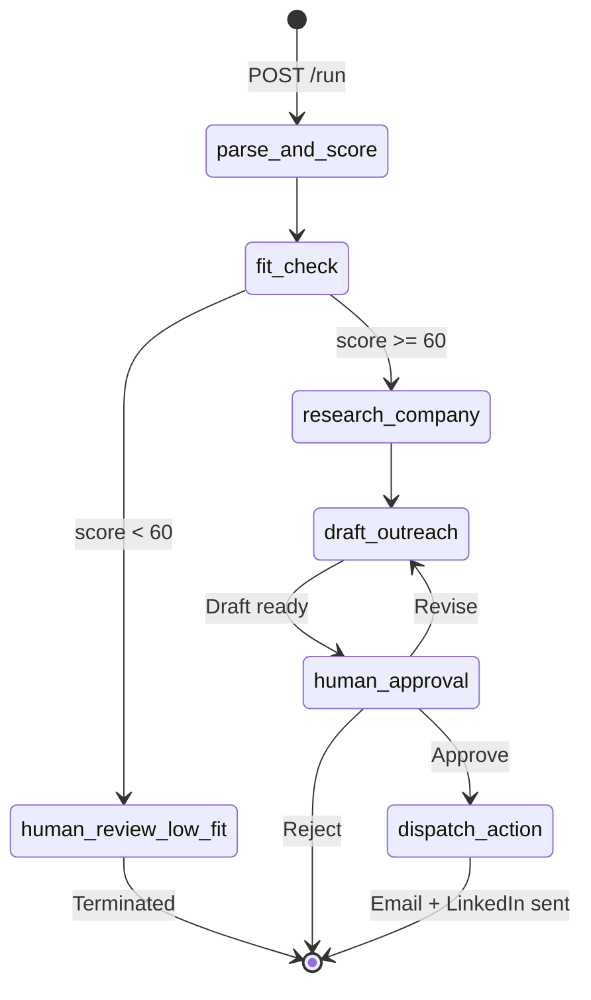
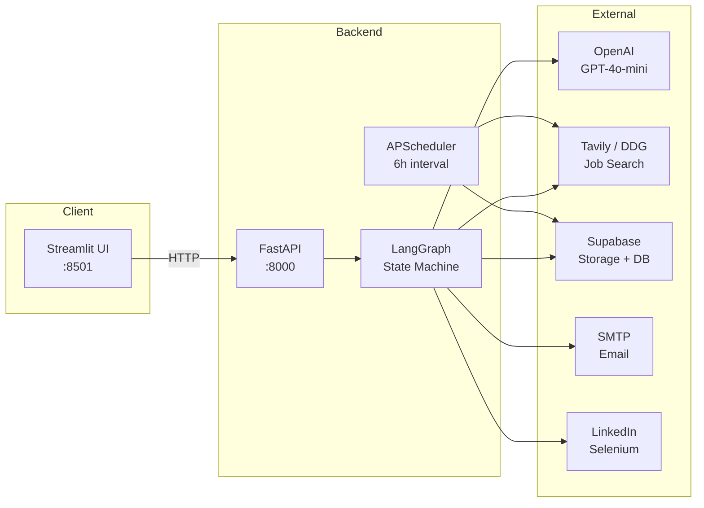

# 🎯 HITL Job Outreach & Application Screener Agent

A production-grade **Human-in-the-Loop** (HITL) AI agent that automates job searching, resume scoring, company research, and outreach drafting — while keeping **you** in control of every decision.

Built with **FastAPI**, **LangGraph**, **Streamlit**, and **Supabase**.

---

## 🏗️ Architecture



### System Overview



---

## ✨ Features

| Feature | Description |
|---------|-------------|
| **Resume Scoring** | LLM scores your resume against declared strengths with evidence extraction |
| **Job Search** | Automated job fetching via Tavily API (DuckDuckGo fallback) every 6 hours |
| **Company Research** | AI-powered company intel (tech stack, news, careers page) |
| **Outreach Drafting** | Generates personalized email + LinkedIn connection notes |
| **Human-in-the-Loop** | Approve / Revise / Reject before anything is sent |
| **LinkedIn Dispatch** | Selenium-based posting via your `li_at` cookie |
| **Email Dispatch** | SMTP-based cold outreach when `REAL_DISPATCH=true` |
| **Supabase Storage** | Resume PDFs + job posts persisted in Supabase |
| **Streamlit Dashboard** | Full UI for running workflows, reviewing drafts, managing settings |

---

## 🚀 Quick Start

### Prerequisites

- Python 3.11+
- Docker & Docker Compose (optional, for containerized deploy)
- API keys: OpenAI, Supabase, Tavily (optional)

### 1. Clone & Install

```bash
git clone https://github.com/parinbajayebin/HITL--Job-Outreach-Application-Screener-Agent.git
cd HITL--Job-Outreach-Application-Screener-Agent

python -m venv venv
source venv/bin/activate       # Windows: venv\Scripts\activate

pip install -r requirements.txt
```

### 2. Configure Environment

Copy the example and fill in your keys:

```bash
cp .env.example .env
```

See [`docs/ENV_SETUP.md`](docs/ENV_SETUP.md) for a detailed guide on where to get each key.

**Required keys:**
| Variable | Where to get it |
|----------|----------------|
| `OPENAI_API_KEY` | [platform.openai.com/api-keys](https://platform.openai.com/api-keys) |
| `SUPABASE_URL` | Supabase Dashboard → Settings → API → Project URL |
| `SUPABASE_KEY` | Supabase Dashboard → Settings → API Keys → `anon` (publishable) key |
| `TAVILY_API_KEY` | [tavily.com](https://tavily.com) (optional — falls back to DuckDuckGo) |

### 3. Run Locally

**Option A — Direct:**

```bash
# Terminal 1: API server
uvicorn app.main:app --reload --port 8000

# Terminal 2: Streamlit UI
streamlit run ui/app.py --server.port 8501
```

**Option B — Docker Compose:**

```bash
docker compose up --build
```

This starts 3 services:
- **API** → `http://localhost:8000`
- **UI** → `http://localhost:8501`
- **Scheduler** → background job fetcher (every 6h)

### 4. Use the App

1. Open `http://localhost:8501`
2. Upload your resume + enter strengths, city, role, dream companies
3. Click **Start Screening Workflow**
4. Watch the dashboard as the AI scores, searches, researches, and drafts
5. **Approve**, **Revise**, or **Reject** the outreach draft
6. If approved, the agent dispatches via email/LinkedIn

---

## 🔐 LinkedIn Selenium Cookie

The agent uses your LinkedIn session cookie (`li_at`) to send connection notes from your account via a headless browser.

### How to get it:

1. Log in to LinkedIn in Chrome
2. Open DevTools (F12) → Application → Cookies → `linkedin.com`
3. Copy the `li_at` cookie value
4. Paste it in the Streamlit Settings page or hit:
   ```bash
   curl -X POST http://localhost:8000/settings/linkedin_cookie \
     -H "Content-Type: application/json" \
     -d '{"cookie": "li_at=YOUR_VALUE_HERE"}'
   ```

> ⚠️ The cookie expires on logout or after ~90 days. Refresh it via the Settings page.

---

## 📁 Project Structure

```
├── app/
│   ├── main.py                 # FastAPI entrypoint
│   ├── config.py               # Pydantic settings (reads .env)
│   ├── api/
│   │   └── settings.py         # LinkedIn cookie update endpoint
│   ├── jobs/
│   │   └── daily_job_fetcher.py  # APScheduler background job
│   └── services/
│       ├── graph.py            # LangGraph state machine
│       ├── llm.py              # OpenAI LLM wrapper
│       ├── search.py           # Tavily + DuckDuckGo job search
│       ├── dispatch.py         # Email + Selenium LinkedIn dispatch
│       ├── extractor.py        # Resume text extraction
│       ├── persistence.py      # SQLite checkpoint saver
│       └── supabase_client.py  # Supabase storage + DB
├── models/
│   ├── state.py                # RequirementProfile, ScreenerState, UserPreferences
│   └── outputs.py              # LLM structured output schemas
├── ui/
│   └── app.py                  # Streamlit dashboard
├── tests/
│   ├── unit/
│   └── integration/
├── docs/
│   └── ENV_SETUP.md            # Environment variable setup guide
├── Dockerfile                  # Multi-stage build with Chromium
├── docker-compose.yml          # API + UI + Scheduler services
├── requirements.txt
└── .gitignore
```

---

## 🔄 API Endpoints

| Method | Path | Description |
|--------|------|-------------|
| `POST` | `/run` | Start a new screening workflow |
| `GET` | `/state/{thread_id}` | Get current workflow state |
| `POST` | `/feedback/{thread_id}` | Submit human feedback (approve/revise/reject) |
| `POST` | `/settings/linkedin_cookie` | Update LinkedIn Selenium cookie |
| `GET` | `/health` | Health check (used by Render keep-alive) |

---

## ☁️ Deploy on Render

1. Push this repo to GitHub
2. Create a new **Web Service** on [render.com](https://render.com)
3. Connect your GitHub repo
4. Set environment = **Docker**
5. Add all `.env` variables in the Render dashboard
6. Set health check path: `/health`
7. Deploy!

The APScheduler pings `/health` every 6 hours to keep the free-tier instance alive.

---

## 🧪 Testing

```bash
# Lint
ruff check .

# Unit tests
pytest tests/unit/ -v

# Integration tests
pytest tests/integration/ -v

# All tests
pytest -v
```

---

## 📄 License

MIT

---

## 🤝 Contributing

1. Fork the repo
2. Create a feature branch (`git checkout -b feature/amazing`)
3. Commit your changes
4. Push and open a PR

---

Built with ❤️ by [parinbajayebin](https://github.com/parinbajayebin)
